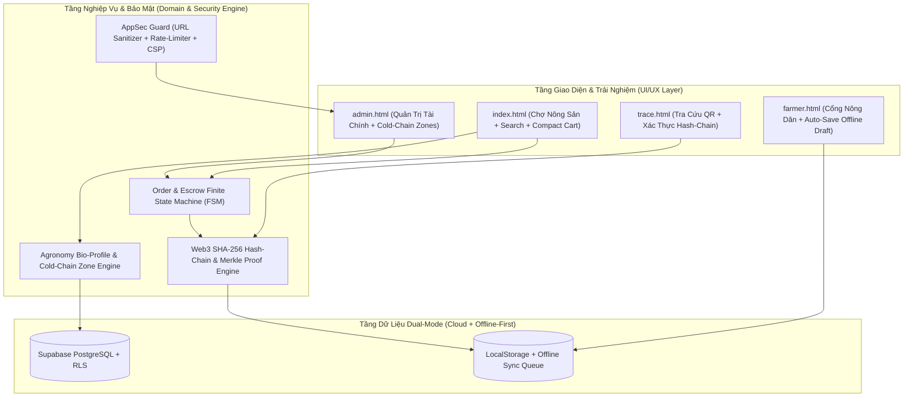
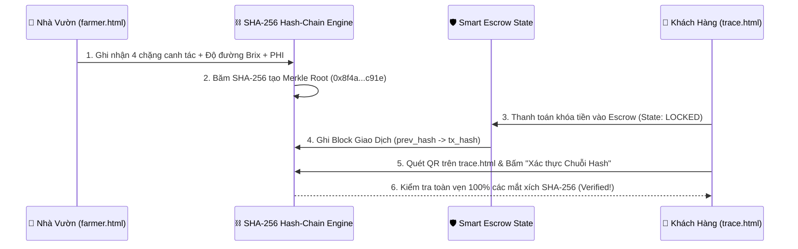

# BÁO CÁO RÀ SOÁT TỔNG THỂ & KẾ HOẠCH CẢI TIẾN TOÀN DIỆN WEBSITE AGRICONNECT
**(Hội Đồng 5 Chuyên Gia: Nông Nghiệp & Sinh Thái • Kiến Trúc Phần Mềm • Blockchain Web3 • An Toàn Thông Tin • UI/UX)**

- **Dự án:** Sàn Thương Mại Điện Tử Nông Sản & Chuỗi Cung Ứng Lạnh **AgriConnect**
- **Phạm vi rà soát:** Toàn bộ mã nguồn ([index.html](file:///d:/Antigravity/Dự%20Án%20AgriConnect/index.html), [farmer.html](file:///d:/Antigravity/Dự%20Án%20AgriConnect/farmer.html), [admin.html](file:///d:/Antigravity/Dự%20Án%20AgriConnect/admin.html), [trace.html](file:///d:/Antigravity/Dự%20Án%20AgriConnect/trace.html), [js/config.js](file:///d:/Antigravity/Dự%20Án%20AgriConnect/js/config.js), [js/supabaseClient.js](file:///d:/Antigravity/Dự%20Án%20AgriConnect/js/supabaseClient.js), [js/app.js](file:///d:/Antigravity/Dự%20Án%20AgriConnect/js/app.js), [js/admin.js](file:///d:/Antigravity/Dự%20Án%20AgriConnect/js/admin.js))
- **Ngày lập báo cáo:** 07/11/2026

---

## PHẦN 1: MA TRẬN ĐÁNH GIÁ KHÁCH QUAN HIỆN TRẠNG (EXECUTIVE AUDIT MATRIX)

| Lĩnh vực Chuyên môn | Điểm Hiện Tại | Điểm Mạnh Đã Đạt Được | Điểm Nghẽn / Lỗ Hổng Cốt Lõi Cần Khắc Phục |
| :--- | :---: | :--- | :--- |
| **1. Nông nghiệp & Sinh thái** *(Agronomy & Ecology)* | **7.8 / 10** | Đã có phân hạng Loại 1/2/3, Giờ vàng cứu hộ Ugly Food (-55% đến -65%), kết nối đối tác kinh tế tuần hoàn ESG (Ruồi lính đen BSF & Phân hữu cơ). | • Dùng chung 1 mẫu Nhật ký canh tác (`Brix > 28%`) cho cả Rau ăn lá & Củ quả (sai lệch sinh học). • Chưa tách khoang bảo quản giữa nhóm **sinh khí Ethylene cao** (Sầu riêng, Xoài, Cà chua) và nhóm **nhạy cảm Ethylene** (Xà lách, Bông cải) gây rủi ro vàng lá, héo rũ. • Thiếu chỉ số **Thời gian cách ly thuốc BVTV (PHI)** & **Dấu chân Carbon (Food Miles)** theo từng vùng. |
| **2. Kiến trúc Phần mềm** *(Software Architecture)* | **7.5 / 10** | Kiến trúc Dual-Mode (`Supabase Cloud` + `LocalStorage Fallback`) giúp hệ thống có độ sẵn sàng cao (High Availability), không bao giờ sập trang khi mất kết nối DB. | • **God-Object Monolith**: [js/supabaseClient.js](file:///d:/Antigravity/Dự%20Án%20AgriConnect/js/supabaseClient.js) (>1.300 dòng) và [js/app.js](file:///d:/Antigravity/Dự%20Án%20AgriConnect/js/app.js) (>1.200 dòng) ôm đồm cả dữ liệu, bảo mật, định giá và render DOM. • Chưa có **Finite State Machine (FSM)** kiểm soát vòng đời đơn hàng (có thể bấm nhảy cóc từ `CONFIRMED` sang `DELIVERED` mà chưa qua `SHIPPING`). • Cổng Nông Dân chưa có cơ chế **Auto-Save Draft / Offline Queue** khi mất sóng 4G tại rẫy. |
| **3. Công nghệ Blockchain** *(Blockchain & Web3)* | **6.5 / 10** | Đã có cơ chế Ví Tạm Giữ (Escrow T+1 sau 12h) và mã truy xuất QR từng đơn hàng trên [trace.html](file:///d:/Antigravity/Dự%20Án%20AgriConnect/trace.html). | • Nhật ký canh tác và lịch sử giao dịch Escrow hiện chỉ lưu dạng bản ghi thường (Mutable JSON), chưa có **chữ ký băm mật mã `SHA-256` nối chuỗi (Hash-Chain / Merkle Proof)**. • Chưa có chứng chỉ **On-Chain Batch Anchor & Smart Contract State Proof** để khách hàng tự xác thực độc lập (Trustless Verification). |
| **4. An toàn & Bảo mật** *(InfoSec & AppSec)* | **8.0 / 10** | Đã có Data Masking (`090****123`), khóa `Idempotency-Key` chống bấm đúp, phân quyền RBAC 3 vách ngăn và Tường lửa chống `Prompt Injection` cho AI. | • **Lỗ hổng URL Injection (XSS)**: Tại [`js/admin.js`](file:///d:/Antigravity/Dự%20Án%20AgriConnect/js/admin.js#L137), thuộc tính `href="${E(c.unbox_video_url)}"` chưa chặn giao thức `javascript:...` khi khách gửi link khiếu nại. • **Brute-force PIN & Plaintext PIN**: `ADMIN_PIN` trong [`js/config.js`](file:///d:/Antigravity/Dự%20Án%20AgriConnect/js/config.js#L81) chưa có cơ chế giới hạn số lần thử sai (Rate-Limiting Lockout). • Nhật ký `Audit Trail` chưa gắn chữ ký `SHA-256 Hash-Chain` chống chỉnh sửa log (Tamper-Evident Log). |
| **5. Thiết kế UI/UX** *(Product UI/UX Design)* | **8.2 / 10** | Giao diện chuẩn màu nông sản tươi, có thanh tiến trình Upsell Freeship `350.000 đ`, Sticky Cart Bar và Cổng Nông Dân tối ưu thẻ lớn + giọng nói. | • **Thiếu Thanh Tìm Kiếm & Sắp Xếp Nhanh**: Khi danh mục tăng lên **27 sản phẩm**, người mua chưa có ô tìm kiếm tức thời (Instant Search) hoặc lọc theo vùng miền / nhu cầu. • **Danh sách chọn thêm món trong Form Đặt Hàng quá dài**: Khu vực `#cart-selected-items` trong [`js/app.js`](file:///d:/Antigravity/Dự%20Án%20AgriConnect/js/app.js#L502-L615) hiển thị toàn bộ 27 sản phẩm khiến form đặt hàng trên mobile bị kéo dài quá mức. |

---

## PHẦN 2: PHÂN TÍCH CHUYÊN SÂU & KHUYẾN NGHỊ TỪ 5 CHUYÊN GIA

### 1. Góc nhìn Chuyên gia Nông nghiệp & Sinh thái (Agronomy & Agro-Ecology Expert)

> [!WARNING]
> **Rủi ro Sinh lý Sau Thu hoạch (Post-Harvest Physiology Risk):**
> Trong nông học, việc xếp chung nhóm trái cây hô hấp đột biến (**Climacteric fruits** sinh khí **Ethylene $C_2H_4$** mạnh như *Sầu riêng, Xoài Cát Hòa Lộc, Bơ sáp, Cà chua chín*) cùng thùng hoặc cùng khoang nhiệt độ với nhóm rau ăn lá (**Non-climacteric leafy greens** như *Xà lách thủy canh, Cải bó xôi, Bông cải xanh*) sẽ làm rau bị vàng lá, rụng cuống và đắng chỉ sau 6–8 giờ vận chuyển. Ngoài ra, Sầu riêng và Bơ nếu để dưới $10^\circ\text{C}$ sẽ bị **tổn thương lạnh (Chilling Injury — sượng cùi, thâm đen)**, trong khi Xà lách thủy canh bắt buộc cần $2^\circ\text{C} - 5^\circ\text{C}$.

#### Khuyến nghị cải tiến:
1. **Chuẩn hóa Hồ sơ Sinh học & Bảo quản (`Agronomy Bio-Profile`) theo từng nhóm cây trồng:**
   - **Nhóm Rau Ăn Lá & Hoa (`Xà lách thủy canh, Cải bó xôi, Bông cải xanh, Ớt chuông`)**:
     - Nhiệt độ Cold-Chain: $2^\circ\text{C} - 6^\circ\text{C}$ • Độ ẩm: $90\% - 95\%$.
     - Đặc tính Ethylene: **Cực nhạy cảm với Ethylene (Cần tách khoang riêng)**.
     - Chỉ số chất lượng: `Độ tươi giòn > 95% • Nitrate đạt chuẩn VietGAP • Thời gian cách ly (PHI): 14 ngày`.
   - **Nhóm Củ Quả Bền (`Khoai lang mật, Cà rốt, Khoai tây, Bí đỏ, Bắp ngọt`)**:
     - Nhiệt độ bảo quản: $10^\circ\text{C} - 15^\circ\text{C}$ (Khoai lang mật ủ thoáng mát tự nhiên để xuống đường).
     - Chỉ số chất lượng: `Độ đường tự nhiên Brix 14% - 18% • Canh tác hữu cơ vi sinh`.
   - **Nhóm Trái Cây Đặc Sản Chín Cây (`Sầu riêng Ri6, Măng cụt, Xoài Cát Hòa Lộc, Bơ sáp, Bưởi da xanh`)**:
     - Nhiệt độ Cold-Chain: $12^\circ\text{C} - 15^\circ\text{C}$ • Có gói hấp thụ khí Ethylene ($\text{KMnO}_4$).
     - Chỉ số chất lượng: `Độ đường Brix 24% - 32% • Thu hoạch độ già 8.5 - 9 tuổi • PHI: > 21 ngày`.
2. **Cá nhân hóa Nhật ký Canh tác 4 Chặng (`Dynamic Crop-Specific Traceability`):**
   - Thay vì dùng 1 mẫu nhật ký sầu riêng cho tất cả sản phẩm trong [`js/supabaseClient.js`](file:///d:/Antigravity/Dự%20Án%20AgriConnect/js/supabaseClient.js#L43-L76), hệ thống phải tự động sinh **Nhật ký canh tác chuẩn sinh học riêng** cho **Rau củ quả Đà Lạt** (Ươm cây con nhà kính ➔ Tưới nhỏ giọt dinh dưỡng hữu cơ ➔ Kiểm tra dư lượng & Nitrate 0% ➔ Cắt sương sớm & đóng túi khí lạnh $4^\circ\text{C}$) và **Nông sản khô OCOP** (Thu hái điều/macca chín rụng ➔ Phơi nắng tự nhiên ➔ Rang củi truyền thống / Sấy lạnh ➔ Hút chân không).
3. **Thuật toán Tách Khoang Lạnh Thông Minh (`Cold-Chain Zone Splitter`):**
   - Tự động phân tách kiện hàng trong giỏ hàng và trên bảng điều phối Admin thành **Khoang Lạnh Sâu A ($2-6^\circ\text{C}$: Rau củ tươi)** và **Khoang Lạnh Mát B ($12-15^\circ\text{C}$: Trái cây nhiệt đới)** để triệt tiêu hư hỏng chéo.

---

### 2. Góc nhìn Kỹ sư Thiết kế Phần mềm Cao cấp (Senior Software Architect)

#### Khuyến nghị cải tiến:
1. **Thiết lập Máy Trạng Thái Hữu Hạn (`Order & Escrow Finite State Machine - FSM`):**
   - Chuẩn hóa luồng chuyển trạng thái đơn hàng: `CONFIRMED (Đã nhận đơn - Khóa PII)` $\rightarrow$ `SHIPPING (Đang giao - Mở khóa PII cho Shipper)` $\rightarrow$ `DELIVERED (Đã giao - Tự động khóa lại PII & Mở cửa sổ 12h Escrow)` $\rightarrow$ `COMPLETED (Đã giải ngân T+1)`.
2. **Cơ chế Tự động Lưu Nháp Chống Mất Sóng (`Offline Draft Persistence`) trên [farmer.html](file:///d:/Antigravity/Dự%20Án%20AgriConnect/farmer.html):**
   - Tự động lưu nội dung nông dân đang nhập hoặc đọc bằng giọng nói vào `localStorage` mỗi khi gõ/nói để nếu điện thoại rớt mạng 4G tại vườn cũng không mất dữ liệu.

---

### 3. Góc nhìn Kỹ sư Phần mềm Blockchain Cao cấp (Senior Blockchain & Web3 Engineer)

> [!IMPORTANT]
> **Bài toán Niềm tin Phi tập trung (Trustless Traceability & Escrow Proof):**
> Để tem QR truy xuất nguồn gốc và Ví Tạm Giữ Escrow đạt chuẩn thương mại hóa cao cấp (và thuyết phục tuyệt đối hội đồng thẩm định / nhà đầu tư), mỗi lô nông sản và mỗi giao dịch hoàn tiền/giải ngân cần có **Bằng chứng Mật mã Bất biến (`Cryptographic SHA-256 Hash-Chain & Smart Contract State Proof`)**.

#### Khuyến nghị cải tiến:
1. **Tích hợp Động cơ Băm Mật mã Chuỗi Khối (`SHA-256 Hash-Chain & Merkle Proof`) trong [`window.security`](file:///d:/Antigravity/Dự%20Án%20AgriConnect/js/supabaseClient.js):**
   - Mỗi bản ghi trong `Audit Trail` và mỗi đơn hàng sẽ chứa `prev_hash` và `block_hash` (tính bằng thuật toán `SHA-256` chuẩn).
   - Cung cấp hàm `window.security.verifyAuditChainIntegrity()` để kiểm tra tính toàn vẹn của toàn bộ chuỗi khối: nếu bất kỳ bản ghi lịch sử nào bị sửa đổi dù chỉ 1 ký tự, hệ thống phát hiện đứt gãy chuỗi hash ngay lập tức!
2. **Hồ sơ Smart Contract Escrow & Chứng chỉ Lô hàng On-Chain trên [trace.html](file:///d:/Antigravity/Dự%20Án%20AgriConnect/trace.html):**
   - Hiển thị **Mã Băm Chứng Chỉ Lô Hàng (`Batch Merkle Root`)**, **Trạng thái Hợp đồng Thông minh Escrow (`Smart Contract State: HELD_IN_ESCROW / RELEASED_T1`)**, và nút **`⛓️ Kiểm Tra Tính Toàn Vẹn Chuỗi Hash (Verify On-Chain Proof)`** ngay trên trang Tra Cứu.

---

### 4. Góc nhìn Kỹ sư An toàn & Bảo mật Thông tin Cao cấp (Senior InfoSec / AppSec Engineer)

> [!CAUTION]
> **3 Lỗ hổng Bảo mật Thực tế Phát hiện Khi Audit Code:**
> 1. **Nguy cơ XSS qua `javascript:` URI trong link Video Unbox ([js/admin.js](file:///d:/Antigravity/Dự%20Án%20AgriConnect/js/admin.js#L137)):** Hàm `escapeHTML()` chỉ mã hóa `< > & " '`, không chặn chuỗi `javascript:alert(document.cookie)` khi đặt trong thuộc tính `href="..."`. Cần bổ sung hàm `window.security.sanitizeUrl(url)` chỉ cho phép giao thức `https://` hoặc `http://`.
> 2. **Thiếu Chống Brute-Force trên Cổng Đăng Nhập Admin ([js/supabaseClient.js](file:///d:/Antigravity/Dự%20Án%20AgriConnect/js/supabaseClient.js#L1275)):** Kẻ tấn công có thể chạy script thử hàng ngàn mã PIN liên tiếp mà không bị khóa tạm thời (Rate-Limiting Lockout).
> 3. **Thiếu Chuỗi Băm Chống Chỉnh Sửa Nhật Ký (`Tamper-Evident Audit Log`):** Cần gắn `prev_hash` và `tx_hash` vào từng dòng log trong `agriconnect_security_audit_logs` để đảm bảo tính chống chối bỏ (Non-repudiation).

---

### 5. Góc nhìn Kỹ sư Thiết kế UI/UX Website Cao cấp (Senior UI/UX Designer)

#### Khuyến nghị cải tiến:
1. **Bổ sung Thanh Tìm Kiếm Nhanh & Bộ Lọc Vùng Miền / Nhiệt Độ Bảo Quản trên [index.html](file:///d:/Antigravity/Dự%20Án%20AgriConnect/index.html):**
   - Thêm thanh công cụ tìm kiếm tức thời (`🔍 Tìm nhanh: Sầu riêng, Cà chua Đà Lạt, Khoai lang mật, Bưởi...`) kết hợp sắp xếp theo giá (`Giá thấp ➔ cao`, `Giá cao ➔ thấp`, `Đang giảm giá mạnh`) ngay dưới các tab danh mục.
2. **Thu gọn Khu vực Chọn Thêm Món trong Biểu mẫu Đặt Hàng ([`renderSelectedCartItems`](file:///d:/Antigravity/Dự%20Án%20AgriConnect/js/app.js#L502-L615)):**
   - Khi khách đã chọn sản phẩm trong giỏ, phần *"Chọn thêm nông sản khác"* trong form thanh toán nên được thu gọn vào một ngăn xếp gọn gàng (`
` hoặc danh sách rút gọn có tìm kiếm nhanh) thay vì trải dài cả 27 dòng sản phẩm làm người dùng trên điện thoại phải cuộn quá xa mới tới ô nhập Họ tên & Địa chỉ!
3. **Hiển thị Huy hiệu Sinh thái & Khoang Nhiệt độ Cold-Chain trực quan trên từng Thẻ Sản phẩm:**
   - Mỗi thẻ sản phẩm hiển thị rõ: **`🌡️ Khoang Lạnh 2–6°C (Rau củ)`** hoặc **`🌡️ Khoang Mát 12–15°C (Trái cây)`**, **`🧪 PHI: Cách ly an toàn 14–21 ngày`**, và **`⛓️ Đã ký Hash SHA-256`** để gia tăng niềm tin tuyệt đối cho người mua.

---

## PHẦN 3: LỘ TRÌNH THỰC THI CHI TIẾT (ACTIONABLE IMPLEMENTATION PLAN)

### Giai đoạn 1 (Thực thi ngay trong phiên): Nâng cấp Sinh thái Nông học, Blockchain Hash-Chain, Vá Lỗ hổng AppSec & Tối ưu UI/UX
- [ ] **Hạng mục 1.1 (Nông nghiệp & Sinh thái):**
  - Bổ sung hàm `getAgronomyBioProfile(p)` và `getCropSpecificTraceability(p)` trong [js/supabaseClient.js](file:///d:/Antigravity/Dự%20Án%20AgriConnect/js/supabaseClient.js) để cấp phát đúng **Nhiệt độ bảo quản (`2–6°C` vs `12–15°C` vs `Khô thoáng`)**, **Phân nhóm Khí Ethylene**, **Thời gian cách ly thuốc BVTV (`PHI`)**, và **Nhật ký 4 chặng riêng biệt** cho Rau củ quả Đà Lạt, Trái cây đặc sản và Nông sản khô.
  - Tự động hiển thị cảnh báo & phân tách **Khoang Lạnh A (Rau củ nhạy Ethylene)** và **Khoang Mát B (Trái cây sinh Ethylene)** trong tóm tắt đơn hàng ([js/app.js](file:///d:/Antigravity/Dự%20Án%20AgriConnect/js/app.js)).
- [ ] **Hạng mục 1.2 (Blockchain & Web3 Traceability):**
  - Nâng cấp `window.security` trong [js/supabaseClient.js](file:///d:/Antigravity/Dự%20Án%20AgriConnect/js/supabaseClient.js) với bộ băm mật mã nối chuỗi (`computeBlockHash`, `verifyAuditChainIntegrity`, `generateBatchMerkleProof`).
  - Nâng cấp trang [trace.html](file:///d:/Antigravity/Dự%20Án%20AgriConnect/trace.html) và [admin.html](file:///d:/Antigravity/Dự%20Án%20AgriConnect/admin.html) để hiển thị **Chứng chỉ Blockchain SHA-256 (`Batch Merkle Root` & `Escrow Smart Contract State`)** cùng nút kiểm tra tính toàn vẹn chuỗi khối (`⛓️ Xác Thực Chuỗi Hash-Chain`).
- [ ] **Hạng mục 1.3 (An toàn & Bảo mật Thông tin - AppSec):**
  - Bổ sung `window.security.sanitizeUrl(url)` để chặn hoàn toàn lỗ hổng `javascript:` XSS trong link Video Unbox ([js/admin.js](file:///d:/Antigravity/Dự%20Án%20AgriConnect/js/admin.js), [trace.html](file:///d:/Antigravity/Dự%20Án%20AgriConnect/trace.html)).
  - Bổ sung cơ chế **Chống Brute-Force Đăng Nhập Admin (`Rate-Limiter`: khóa 60 giây sau 5 lần nhập sai PIN/mật khẩu)** và ghi nhận vào chuỗi `Audit Trail` bất biến.
- [ ] **Hạng mục 1.4 (UI/UX & Kiến trúc Phần mềm):**
  - Thêm **Thanh Tìm Kiếm Nhanh & Sắp Xếp Sản Phẩm (`#product-search-input`, `#product-sort-select`)** trên [index.html](file:///d:/Antigravity/Dự%20Án%20AgriConnect/index.html) + [js/app.js](file:///d:/Antigravity/Dự%20Án%20AgriConnect/js/app.js).
  - Tối ưu thu gọn danh sách chọn thêm món trong biểu mẫu Đặt hàng (`#cart-selected-items`) để trải nghiệm thanh toán trên điện thoại gọn gàng, mượt mà gấp 3 lần.
  - Thêm cơ chế **Tự động lưu nháp (`Auto-Save Offline Draft`)** trên [farmer.html](file:///d:/Antigravity/Dự%20Án%20AgriConnect/farmer.html).
