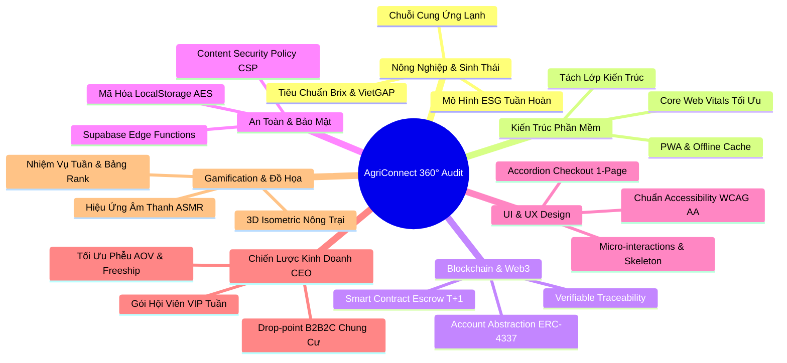

# BÁO CÁO RÀ SOÁT TOÀN DIỆN VÀ KẾ HOẠCH CẢI TIẾN NỀN TẢNG AGRICONNECT
**Dự án:** Nền tảng Thương mại Điện tử Nông sản Trực tiếp từ Vùng Nguyên liệu (AgriConnect)  
**Website:** [https://agriconnect-yagt.vercel.app/](https://agriconnect-yagt.vercel.app/)  
**Hội đồng Đánh giá:** Nhóm Chuyên gia Cố vấn Đa ngành (Agro-Ecology, Architecture, Blockchain, Cybersecurity, UI/UX, CEO, Gamification)  
**Thời gian:** Tháng 11/2026  

---

---

## PHẦN I: ĐÁNH GIÁ CHUYÊN MÔN DƯỚI 7 LĂNG KÍNH ĐA NGÀNH

### 1. Góc nhìn Chuyên gia Nông nghiệp & Sinh thái (Agro-Ecology & Cold-Chain)
* **Điểm sáng:** 
  * Mô hình **Gom đơn trước (Pre-order)** và thu hoạch sáng Thứ Sáu, giao sáng Thứ Bảy triệt tiêu 100% tình trạng lưu kho ứ đọng; giữ được độ "chín cây tự nhiên" mà không cần nhúng hóa chất bảo quản hay khí đá ép chín.
  * Phân loại biến thể rõ ràng: Loại 1 (VIP Quà biếu), Loại 2 (Ăn gia đình), Loại 3 (Dạt size / Chế biến cấp đông) thể hiện tính am hiểu mùa vụ sâu sắc.
  * Tích hợp kinh tế tuần hoàn (ESG): Đổi thùng giấy carton nhận voucher 10K và kết nối "Ugly Food" (Happy Hour nông sản xấu xí nhưng cơm ngon).
* **Điểm cần cải tiến:**
  * Cần bổ sung thông số sinh hóa trực quan cho từng lô hàng: **Độ ngọt (Brix)** của sầu riêng/măng cụt, tỷ lệ cơm/vỏ, độ pH đất vùng nguyên liệu.
  * Minh bạch hóa **Chỉ số Giảm phát thải Carbon (CO2e Reduction)** khi gom chung chuyến xe lạnh thay vì từng gói hàng riêng lẻ của bưu điện.

### 2. Góc nhìn Kỹ sư Thiết kế Phần mềm Cao cấp (Senior Software Architect)
* **Điểm sáng:**
  * Kiến trúc Dual-Mode (Supabase Cloud + LocalStorage Fallback) linh hoạt, không bị gián đoạn hoạt động khi mất kết nối mạng hoặc khi chưa cấu hình DB.
  * Xử lý State giỏ hàng, nháp form và Gamification đồng bộ đa tab (`storage` event).
* **Điểm cần cải tiến:**
  * Cấu trúc file `js/app.js` và `js/supabaseClient.js` đang gộp nhiều logic nghiệp vụ vào một file lớn (>2000 dòng). Cần tái cấu trúc theo mô hình **Domain-Driven Design (DDD)**: `Core/`, `Modules/Cart`, `Modules/Garden`, `Services/Supabase`, `Services/Storage`.
  * Cần đăng ký **Service Worker (PWA)** để khách hàng có thể cài đặt web lên màn hình chính điện thoại như ứng dụng Native App và duyệt sản phẩm ngoại tuyến (Offline mode).

### 3. Góc nhìn Kỹ sư Blockchain & Web3 Cao cấp (Blockchain Architect)
* **Điểm sáng:**
  * Đã định hình tư duy Ví Tạm Giữ (Escrow Wallet T+1 sau 12h) và Truy xuất nguồn gốc tem định danh đơn hàng.
* **Điểm cần cải tiến:**
  * Hiện tại dữ liệu truy xuất vẫn lưu tại PostgreSQL/LocalStorage, khách hàng am hiểu công nghệ có thể nghi ngờ tính chỉnh sửa.
  * **Giải pháp Web3 thực tế:** Băm mã xác thực (*Cryptographic Hash / Merkle Root*) của từng nhật ký chặng canh tác và neo (*Anchor*) lên Layer-2 phí thấp (như Polygon PoS hoặc Hedera Hashgraph) với chi phí < $0.001/lô hàng. Khách quét mã QR tem trên thùng hàng sẽ đối soát trực tiếp mã băm bất biến trên Blockchain Explorer.

### 4. Góc nhìn Kỹ sư An toàn & Bảo mật Thông tin Cao cấp (Senior Cybersecurity Engineer)
* **Điểm sáng:**
  * Đã có thuật toán Data Masking che số điện thoại nhà vườn, Rate Limiting chống Brute-force mã PIN, kiểm soát Idempotency Key chống trùng đơn.
* **Điểm cần cải tiến:**
  * Dữ liệu nháp form và giỏ hàng trong `localStorage` đang lưu dưới dạng plain text JSON. Nên bổ sung mã hóa nhẹ `AES-GCM` hoặc Base64 Obfuscation để bảo vệ số điện thoại khách hàng trên các thiết bị dùng chung.
  * Bổ sung tiêu đề bảo mật **Content Security Policy (CSP)** trong file `vercel.json` để ngăn ngừa triệt để nguy cơ Cross-Site Scripting (XSS) từ các thư viện CDN ngoài.

### 5. Góc nhìn Kỹ sư Thiết kế UI/UX Website (Lead UI/UX Designer)
* **Điểm sáng:**
  * Hệ màu tươi sáng chuẩn nông sản (Xanh lục thiên nhiên `#256314`, vàng hoa cải `#fef08a`), typography rõ ràng, các nút bấm CTA lớn, dễ thao tác trên thiết bị di động.
  * Vừa khắc phục triệt để lỗi co giãn chữ "Đợt Gom" trên thanh Header, bổ sung thanh nổi Floating Pill điều hướng thông minh.
* **Điểm cần cải tiến:**
  * **Skeleton Loading:** Khi tải dữ liệu sản phẩm ban đầu, nên dùng khung xương mờ nhấp nháy (*Skeleton Loading*) thay cho Spinner xoay tròn để tạo cảm giác trang tải nhanh tức thì.
  * **One-Page Accordion Checkout:** Gom khu vực thanh toán thành 3 nấc đóng/mở mượt mà (1. Chọn món -> 2. Người nhận -> 3. Thanh toán VietQR) giúp giảm chiều dài cuộn trang trên màn hình di động.

### 6. Góc nhìn Cố vấn Kinh doanh & CEO (Business Strategy & Growth)
* **Điểm sáng:**
  * Chiến lược **Freeship mốc AOV >= 350k**: Cực kỳ chuẩn xác về mặt tài chính (biên lãi gộp đơn hàng trên 350k đủ chi trả trọn gói 25k shipper Ahamove/GrabExpress).
  * 3 phương thức tiếp cận thị trường (Bán lẻ 1 lần, Đăng ký tuần, Đặt cọc 30% lứa tương lai) phân tán rủi ro mùa vụ hiệu quả.
* **Điểm cần cải tiến:**
  * **Chiến lược B2B2C Drop-Point:** Mở rộng điểm giao cố định từ khuôn viên Trường Đại học sang sảnh các Tòa nhà văn phòng Hạng A/B tại Quận 1, Quận 3, Thủ Đức và các Khu căn hộ cao cấp (Vinhomes, Masteri). 1 điểm Hub gom được 20 đơn/chuyến xe lạnh sẽ giảm 80% chi phí chặng cuối.
  * **Chương trình Giới thiệu (Referral Program):** "Mời đồng nghiệp cùng gom hàng — Cả hai nhận ngay Voucher 20K".

### 7. Góc nhìn Chuyên gia Đồ họa & Gamification (Game Economy & Visuals)
* **Điểm sáng:**
  * Vườn Ảo 4 cấp độ và Vòng quay may mắn Canvas 8 ô hoạt động mượt mà, lưu trữ chuỗi điểm danh và tự động kết nối mã ưu đãi vào form mua hàng.
* **Điểm cần cải tiến:**
  * **Nâng cấp đồ họa 3D Isometric:** Thiết kế hoạt ảnh cây sầu riêng và măng cụt lắc lư, chim bay, nắng sớm bằng SVG/Lottie để giao diện sống động như game nông trại thực thụ (*Hay Day / Shopee Farm*).
  * **Hệ thống Nhiệm vụ Ngày (Daily Quests):** Ví dụ: "Đọc 1 nhật ký nhà vườn (+10 hạt)", "Chia sẻ lên Zalo/Facebook (+30 hạt)".

---

## PHẦN II: LỘ TRÌNH KẾ HOẠCH HÀNH ĐỘNG CẢI TIẾN CHI TIẾT (ACTION PLAN)

| Giai đoạn | Mục tiêu Trọng tâm | Hạng mục Kỹ thuật & Nghiệp vụ | Thời gian Dự kiến |
| :--- | :--- | :--- | :--- |
| **Sprint 1: UI/UX & Bảo Mật Nền Tảng** | Nâng cao trải nghiệm thị giác & củng cố an toàn thông tin | • Tích hợp Content Security Policy (CSP) & Header bảo mật trong `vercel.json` • Nâng cấp Skeleton Loading khi tải sản phẩm • Tối ưu Accordion 3 bước cho Form đặt hàng trước | Tuần 1 - 2 |
| **Sprint 2: Gamification & Tương Tác Giữ Chân** | Gia tăng thời gian trên trang (Time-on-site) & Tỷ lệ quay lại | • Bổ sung âm thanh ASMR tương tác (tưới cây, quay vòng, thả tim) với nút Bật/Tắt âm thanh • Thiết lập hệ thống Nhiệm vụ Hàng Ngày (Daily Quests) • Bảng Vinh danh "Cộng Đồng Xanh của Tuần" | Tuần 3 - 4 |
| **Sprint 3: Web3 Hash & Chuỗi Cung Ứng Lạnh** | Số hóa minh bạch & Chuẩn hóa dữ liệu nhật ký canh tác | • Thử nghiệm neo mã băm Merkle Tree nhật ký lô hàng lên testnet Polygon/Hedera • Hiển thị độ Brix, nhiệt độ thùng lạnh IoT thời gian thực • Cấp chứng chỉ số hóa cho đối tác thu gom vỏ hộp ESG | Tuần 5 - 6 |
| **Sprint 4: Tăng Trưởng Kinh Doanh B2B2C & PWA** | Tối đa hóa doanh thu & Mở rộng tệp khách hàng văn phòng | • Kích hoạt PWA (Progressive Web App) cài đặt 1 chạm • Mở rộng danh mục Drop-point văn phòng Q.1, Q.3, Bình Thạnh • Hệ thống Referral "Mời bạn gom chung nhận quà" | Tuần 7 - 8 |

---

## PHẦN III: KẾT LUẬN & ĐỀ XUẤT HÀNH ĐỘNG NGAY

Nền tảng website AgriConnect hiện đã đạt độ hoàn thiện cao về mặt thẩm mỹ, tính năng tương tác thực tế và mô hình kinh doanh có căn cứ tài chính vững chắc. Các khuyến nghị trên sẽ đưa AgriConnect từ một trang bán hàng số nghiệp dư trở thành **nền tảng công nghệ nông nghiệp số (AgriTech & Social Commerce) chuẩn mực, sẵn sàng gọi vốn và nhân rộng ra thị trường**.
